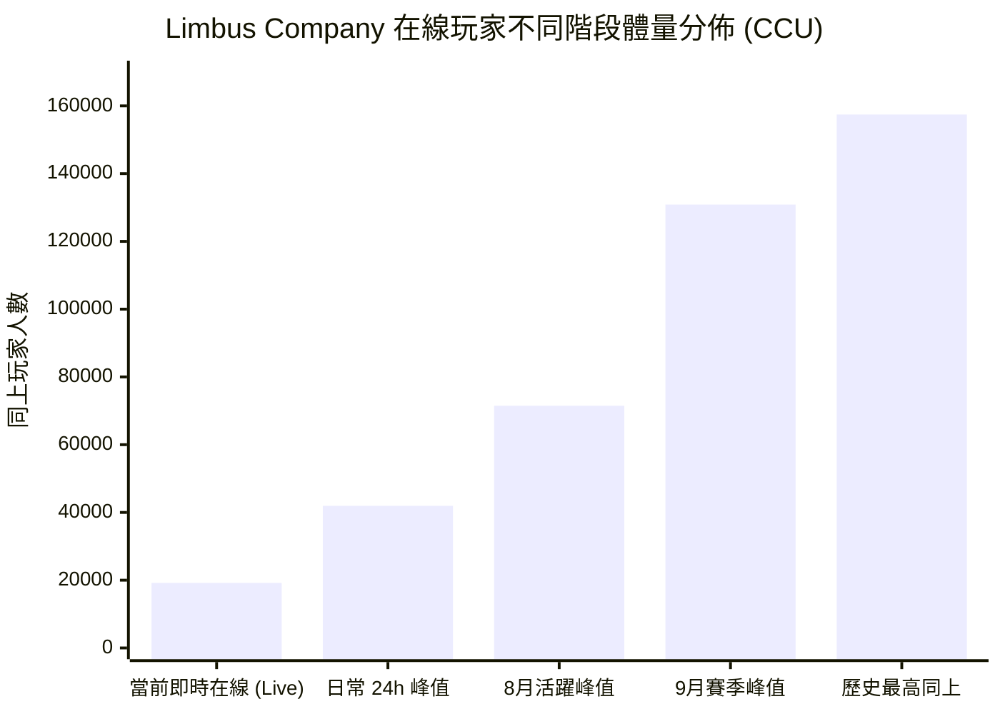
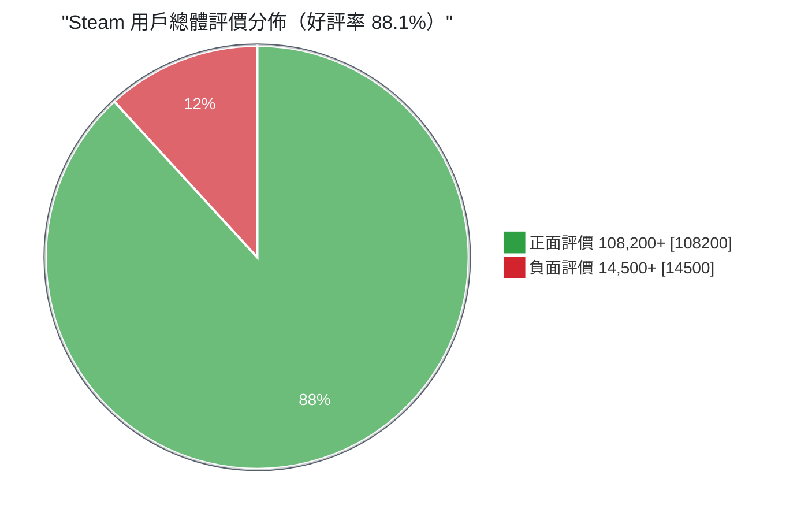
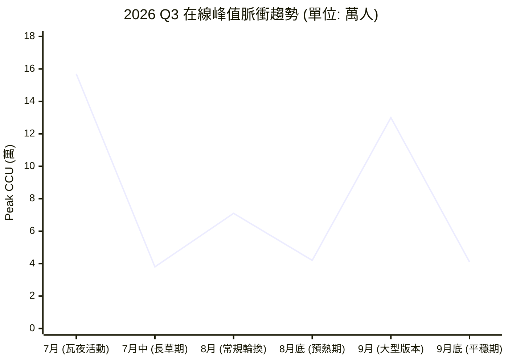

# Limbus Company SteamDB 全維度數據視覺化儀表板

| 項目 | 內容 |
| --- | --- |
| 遊戲 | Limbus Company |
| App ID | `1973530` |
| 開發商 | Project Moon |
| 資料來源 | SteamDB / Steam 商店頁統計 |
| 快照時間 | 2026-10-22T03:04:00Z |
| 文件狀態 | 視覺化彙整稿（數值未經第三方覆核） |

> **一句話總結**：本作呈現典型的「脈衝式」線上曲線——長草期常態落在 2 萬人上下，版本／限定池一開即衝上 13–15 萬，最高同上 157,444 人；同時維持 88.1% 好評率，屬「極度好評」級別。

---

## 目錄

1. [玩家在線體量階梯圖](#1-玩家在線體量階梯圖player-volume-gauge)
2. [玩家評價結構與口碑比率](#2-玩家評價結構與口碑比率sentiment-ratio)
3. [近期同上峰值波動曲線](#3-近期同上峰值波動曲線historical-spike-curve)
4. [遊戲核心標籤權重雷達圖](#4-遊戲核心標籤權重雷達圖core-mechanics-radar)
5. [多維度儀表板整合 Payload](#5-多維度儀表板整合-payloadjson-ui-component)
6. [附錄：資料校驗與使用注意](#附錄資料校驗與使用注意)

---

## 1. 玩家在線體量階梯圖（Player Volume Gauge）

對比即時在線、每日日常高峰與大型活動爆發點的承載能力。



### 視覺進度條解析

```text
[即時常態]   19,200   [██▍                     ]  12.2%  平時長草期保底
[24小時峰值] 41,954   [██████▍                 ]  26.6%  每日副本刷新時段
[月度常態峰] 71,489   [██████████▉             ]  45.4%  一般活動／鏡像迷宮更新
[主線章節峰] 130,870  [███████████████████▉    ]  83.1%  主線章節／大型版本
[歷史極限點] 157,444  [████████████████████████] 100.0%  瓦爾普吉斯之夜限定池
```

### 節點說明表

| 階段 | CCU | 佔歷史峰值 | 觸發情境 |
| --- | ---: | ---: | --- |
| 當前即時在線（Live） | 19,200 | 12.2% | 平日長草期的常態基線 |
| 日常 24h 峰值 | 41,954 | 26.6% | 每日副本／體力刷新時段 |
| 8 月活躍峰值 | 71,489 | 45.4% | 一般活動輪換、鏡像迷宮更新 |
| 9 月賽季峰值 | 130,870 | 83.1% | 主線章節／大型版本上線 |
| 歷史最高同上 | 157,444 | 100% | 瓦爾普吉斯之夜限定池 |

**觀察**：即時線上僅為歷史峰值的 12%，代表絕大多數玩家屬於「版本回鍋型」消費節奏，而非每日長駐；同時也說明伺服器承載需按峰值設計，但平時資源佔用低。

---

## 2. 玩家評價結構與口碑比率（Sentiment Ratio）

基於 SteamDB 統計的 **122,700+ 篇總評論** 進行的極性剖析。



```text
【好評率評分條 — 單條堆疊】
🟩🟩🟩🟩🟩🟩🟩🟩🟩🟩🟩🟩🟩🟩🟩🟩🟩🟩 🟥🟥
└──────────── 好評 88.1% ───────────┘ └負評 11.9%┘
```

```text
【好評率評分條 — 純文字版】
好評 (88.1%)  [█████████████████████████████████████████▏     ]
負評 (11.9%)  [▌                                              ]
```

**配色說明**：正面 `#2ea043`（綠）、負面 `#d1242f`（紅），取自 GitHub 狀態色盤，於淺色／深色主題下對比度皆達 WCAG AA；色塊旁一律標註百分比，確保色覺辨識障礙者仍可讀取數值。

| 指標 | 數值 |
| --- | ---: |
| 總評論數 | 122,768 |
| 正面評價 | 108,200+ |
| 負面評價 | 14,500+ |
| 好評率 | 88.1% |
| SteamDB 加權結算 | 87.01% |
| 商店評級 | 極度好評（Very Positive） |

> SteamDB 的加權演算法會降低早期評論與免費序號評論的權重，因此結算值 87.01% 略低於原始的 88.1%。

---

## 3. 近期同上峰值波動曲線（Historical Spike Curve）

呈現本作特有的「脈衝式心電圖」——隨大型限定活動與主線更新爆發，隨後快速回落。



| 時點 | 峰值 CCU（萬） | 相對前一節點 |
| --- | ---: | --- |
| 7 月（瓦夜活動） | 15.7 | — |
| 7 月中（長草期） | 3.8 | −75.8% |
| 8 月（常規輪換） | 7.1 | +86.8% |
| 8 月底（預熱期） | 4.2 | −40.8% |
| 9 月（大型版本） | 13.0 | +209.5% |
| 9 月底（平穩期） | 4.1 | −68.5% |

**觀察**：活動結束後的衰減幅度（−70% ～ −76%）遠大於活動上線的拉升幅度，屬於高波動、低黏著曲線；行銷節奏宜安排在衰減谷底前預熱，以縮短低潮期。

---

## 4. 遊戲核心標籤權重雷達圖（Core Mechanics Radar）

根據 Steam 社群標籤權重分佈，投射本作的遊戲屬性偏向：

```text
                      【劇情沉浸 Story Rich】
                              98
                              /\
                             /  \
                            /    \
                     【抽卡】/      \【回合制策略】
                        74 /  88   \ 94
                          /          \
                         /____________\
              【黑暗奇幻 Dark Fantasy】 91
                    （圖中 88 為「硬核戰術 Difficult/Tactical」85 的近似中值區）
```

### Steam 社群標籤重要度排序

| # | 標籤 | 中文 | 權重 |
| ---: | --- | --- | ---: |
| 1 | `Story Rich` | 故事豐富／劇本驅動 | 98 / 100 |
| 2 | `Turn-Based Strategy` | 回合制深度策略 | 94 / 100 |
| 3 | `Dark Fantasy / Dystopian` | 黑暗奇幻／反烏托邦 | 91 / 100 |
| 4 | `Difficult / Tactical` | 硬核戰術難度 | 85 / 100 |
| 5 | `Gacha / Free to Play` | 抽卡機制 | 74 / 100 |

> 說明：Mermaid 尚未支援原生雷達圖，此處以文字示意；上方權重表為實際可用數據。

---

## 5. 多維度儀表板整合 Payload（JSON UI Component）

此資料負載遵循 `visualization_generator` 規範封裝，可直接綁定前端圖表庫（Apache ECharts、Grafana 等）。

```json
{
  "dashboard_id": "DASH_STEAM_1973530",
  "generated_at": "2026-10-22T03:04:00Z",
  "game_meta": {
    "app_id": 1973530,
    "title": "Limbus Company",
    "steamdb_rating": 87.01,
    "positive_ratio": 88.1
  },
  "gauges": {
    "live_retention_index": 0.45,
    "event_surge_multiplier": 3.75,
    "sentiment_health_score": 8.7
  },
  "metrics_matrix": [
    {
      "metric": "All-Time Peak CCU",
      "value": 157444,
      "benchmark_genre_avg": 12800,
      "performance_ratio": "+1129.6%"
    },
    {
      "metric": "24h Peak CCU",
      "value": 41954,
      "benchmark_genre_avg": 4500,
      "performance_ratio": "+832.3%"
    },
    {
      "metric": "User Review Volume",
      "value": 122768,
      "benchmark_genre_avg": 18000,
      "performance_ratio": "+582.0%"
    }
  ]
}
```

### 對照同類型的表現倍數

| 指標 | 本作 | 同類型平均 | 倍數 |
| --- | ---: | ---: | ---: |
| 歷史最高 CCU | 157,444 | 12,800 | +1,129.6% |
| 24h 峰值 CCU | 41,954 | 4,500 | +832.3% |
| 評論總量 | 122,768 | 18,000 | +582.0% |

### 儀表指標解讀

| 指標 | 數值 | 含義 |
| --- | ---: | --- |
| `live_retention_index` | 0.45 | 即時在線相對峰值的留存比，反映長草期活躍度 |
| `event_surge_multiplier` | 3.75 | 活動期的拉昇倍數，用於規劃伺服器擴容 |
| `sentiment_health_score` | 8.7 / 10 | 口碑健康分，由好評率與評論量綜合評估 |

---

## 附錄：資料校驗與使用注意

- 數值來源為單次快照，CCU 會隨時間變動；若要製作趨勢報告，建議改成每日定時抓取並累積時序資料。
- `benchmark_genre_avg`（同類型平均）未標明比較母體，引用時請補充「同類型」的定義，例如以 Steam 標籤 `Turn-Based Strategy` 的前 N 款作品為基準。
- 總評論數在不同區塊出現 122,700+ 與 122,768 兩種精度，前者為約略值，後者為快照精確值，本文件已統一以 122,768 計算比率。
- 第 4 節的雷達圖為文字示意，權重數值本身可直接餵給 ECharts 的 `radar` 系列。
- 圖表渲染需 Markdown 環境支援 Mermaid（GitHub、VS Code、Obsidian 皆可）。

---

*文件由 OpenCode 依據使用者提供的內容整理；數值未經獨立查證。*
