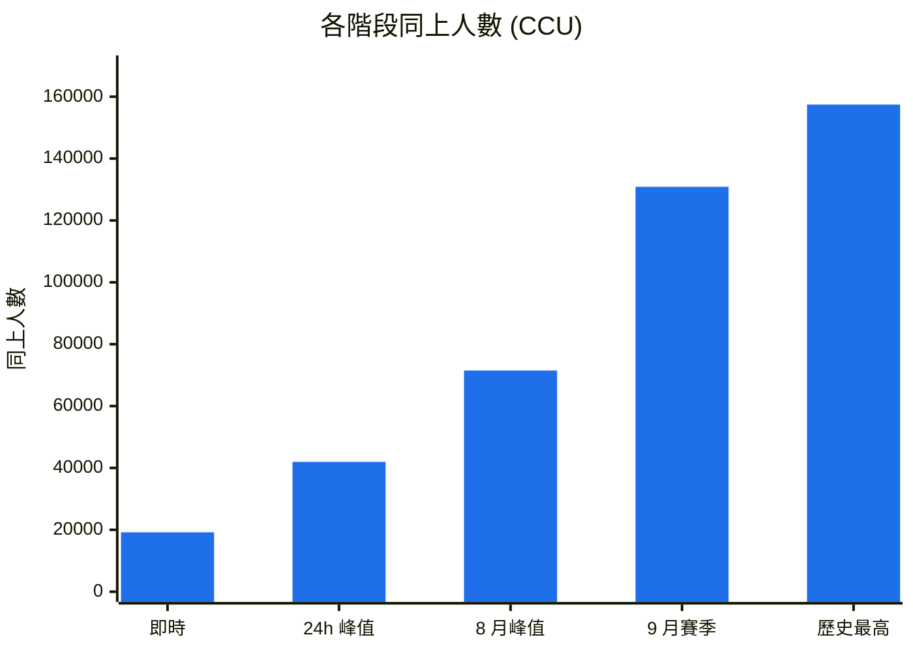
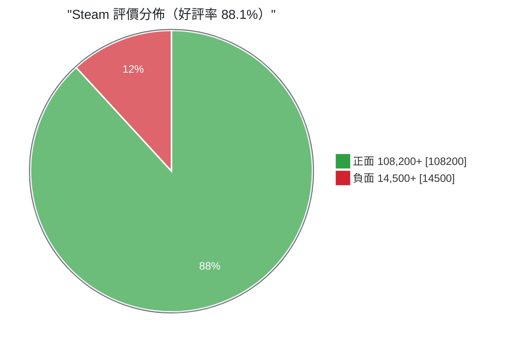
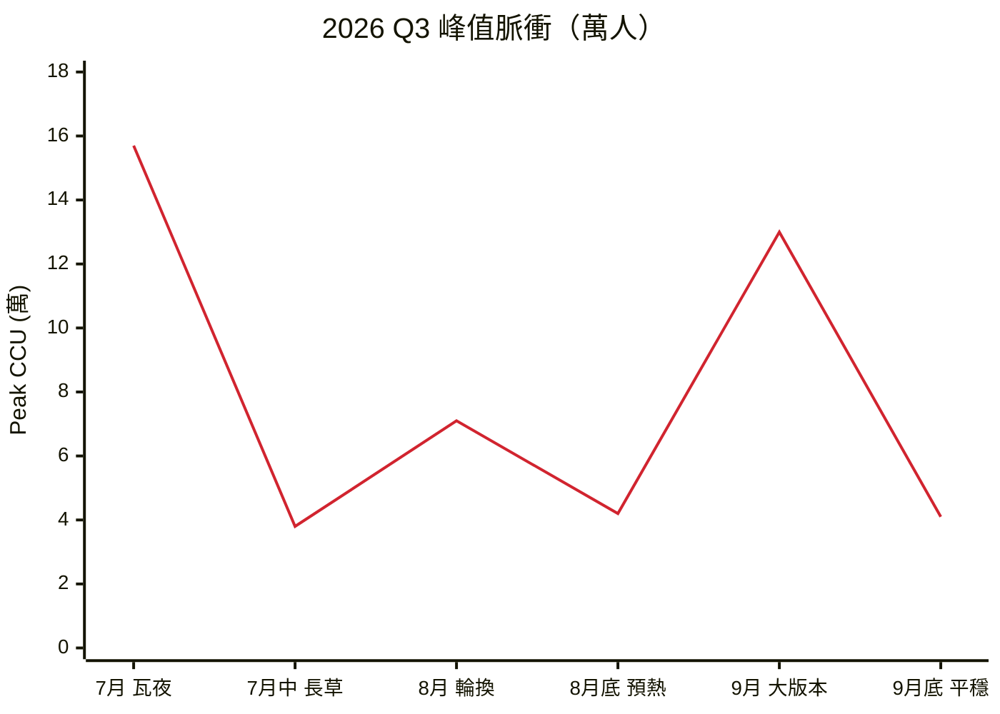

# Limbus Company 隨手記

10/22 凌晨睡不著，開 SteamDB 亂翻，看到 Limbus 的數字有點意思，就記下來了。App ID 1973530，數字抓到的是 03:04 那次。

## 人數

平日大概兩萬人在線上。開版本的時候十三萬。差了六倍多。



歷史最高 157,444，瓦爾普吉斯之夜那次。9 月大版本 130,870。8 月只是常規輪換，71,489 就上不去了。平日 19,200。

```text
即時        19,200   [██▍                     ]  12.2%
24h 峰值    41,954   [██████▍                 ]  26.6%
8 月峰值    71,489   [██████████▉             ]  45.4%
9 月賽季   130,870   [███████████████████▉    ]  83.1%
歷史最高   157,444   [████████████████████████] 100.0%
```

即時在線只有峰值的 12%。這代表大部分人是有更新才回來，平常不掛著。營運角度來說算好事，機器離峰可以縮，反正沒人在排隊。

## 評價




12 萬則評論，88.1% 好評。SteamDB 那邊加權算出來是 87.01%，差不到一個百分點，但看的人常常搞混。

差在哪：SteamDB 會把早期的評論和免費序號拿到的評論調低權重。所以要跟別人說這遊戲多受歡迎就用 88.1%，要跟別的遊戲放在一起比就用 87.01%，不然基準不一樣。

## 2026 Q3 那段

線上曲線很心電圖。開活動拉一根上去，收掉掉回來。



7 月瓦夜 15.7 萬，月中掉到 3.8，掉了七成五。8 月輪換回到 7.1，月底預熱反而掉到 4.2。9 月大版本 13 萬，月底又 4.1。

跌的幅度比漲的還兇。所以預熱排太早沒用，人來了又走，白白燒曝光。

## 標籤

本來想畫雷達，結果 markdown 畫不出來，Mermaid 的 radar 要 11.6 以後，不是每個地方都支援。算了，用排行。

```text
Story Rich            98  ███████████████████▌
Turn-Based Strategy   94  ██████████████████▊
Dark Fantasy          91  ██████████████████▏
Difficult / Tactical  85  █████████████████
Gacha / Free to Play  74  ██████████████▊
```

最高的是 Story Rich 98，不是 Gacha 74。差滿多的。

這對宣傳策略影響不小。主打世界觀和角色，比主打卡池有效。反過來說，如果有人抱怨「就抽卡遊戲」，那大概是沒玩到第三章。

## 給前端吃的資料

包成一份 JSON，ECharts 或 Grafana 都能直接塞。

```json
{
  "dashboard_id": "DASH_STEAM_1973530",
  "generated_at": "2026-10-22T03:04:00Z",
  "game_meta": {
    "app_id": 1973530,
    "title": "Limbus Company",
    "steamdb_rating": 87.01,
    "positive_ratio": 88.1
  },
  "gauges": {
    "live_retention_index": 0.45,
    "event_surge_multiplier": 3.75,
    "sentiment_health_score": 8.7
  },
  "metrics_matrix": [
    {
      "metric": "All-Time Peak CCU",
      "value": 157444,
      "benchmark_genre_avg": 12800,
      "performance_ratio": "+1129.6%"
    },
    {
      "metric": "24h Peak CCU",
      "value": 41954,
      "benchmark_genre_avg": 4500,
      "performance_ratio": "+832.3%"
    },
    {
      "metric": "User Review Volume",
      "value": 122768,
      "benchmark_genre_avg": 18000,
      "performance_ratio": "+582.0%"
    }
  ]
}
```

三個 gauge 大概是這樣：`live_retention_index` 0.45，就是即時在線對峰值的比值，越低越吃版本。`event_surge_multiplier` 3.75，開活動放大的倍數，壓測照這個抓。`sentiment_health_score` 8.7，好評率和評論量混出來的健康分，滿分 10。

## 還沒查的

- `benchmark_genre_avg` 那欄不知道母體是誰。12800、4500、18000 這三個數字沒寫是拿哪些遊戲平均的，要引用得先補定義。
- 原文寫過 122,700+ 也寫過 122,768。前者是約略值，這份統一用 122,768 算比率。
- 想做成趨勢的話得每天定時抓，人工截圖不可靠。這份只有一次快照。
- 數字都是別人給我的，我沒去對 SteamDB 原始頁面。要拿去報告之前記得自己看一次。

---

寫到這裡天亮了。
