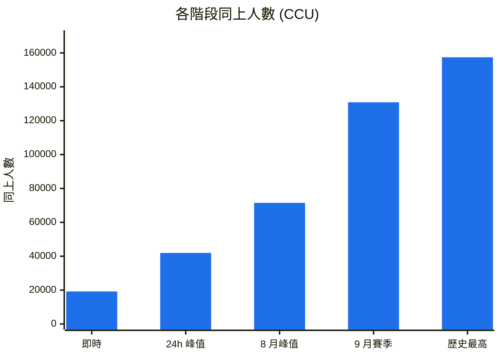
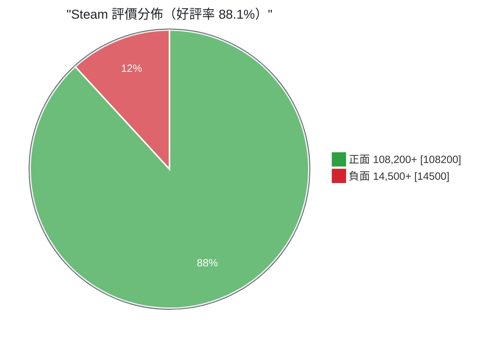
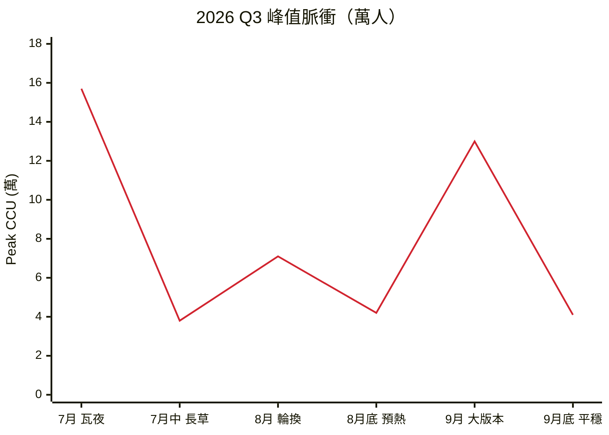

# Limbus Company 數據觀察筆記

把 SteamDB 上抓到的數字整理成一份能直接丟給人看的東西。App ID `1973530`，資料時間 2026-10-22 03:04 UTC。


## 先講重點

- 平時大概 2 萬人在線，一開版本就跳到 13～15 萬。這不是穩定成長的曲線，是一年幾次的爆量。
- 爆完掉得很快，活動收掉兩週內就打回 4 萬上下。能撐住的地方是劇情，不是玩法迴圈。
- 12 萬則評論、88.1% 好評。SteamDB 加權後 87.01%，掛在「極度好評」。
- 標籤權重最高的是 Story Rich，不是 Gacha。行銷上這點很重要：這遊戲賣的是劇本。

## 目錄

1. [線上人數：一條會跳的階梯](#1-線上人數一條會跳的階梯)
2. [評價結構：88.1% 好評，但別只看這個數字](#2-評價結構881-好評但別只看這個數字)
3. [2026 Q3 的峰值是怎麼跑的](#3-2026-q3-的峰值是怎麼跑的)
4. [玩家為什麼買單：標籤權重](#4-玩家為什麼買單標籤權重)
5. [丟給前端用的 payload](#5-丟給前端用的-payload)
6. [備註](#6-備註)

---

## 1. 線上人數：一條會跳的階梯

五個階段的量級排在一起，右邊那根就是極限值。



```text
即時        19,200   [██▍                     ]  12.2%
24h 峰值    41,954   [██████▍                 ]  26.6%
8 月峰值    71,489   [██████████▉             ]  45.4%
9 月賽季   130,870   [███████████████████▉    ]  83.1%
歷史最高   157,444   [████████████████████████] 100.0%
```

| 階段 | CCU | 佔歷史峰值 | 什麼時候會出現 |
| --- | ---: | ---: | --- |
| 即時在線 | 19,200 | 12.2% | 平日長草，沒活動沒新池 |
| 24h 峰值 | 41,954 | 26.6% | 每日副本、體力刷新時段 |
| 8 月峰值 | 71,489 | 45.4% | 一般活動輪換、鏡像迷宮更新 |
| 9 月賽季 | 130,870 | 83.1% | 主線章節、大型版本上線 |
| 歷史最高 | 157,444 | 100% | 瓦爾普吉斯之夜限定池 |

即時在線只有峰值的 12%。意思是絕大多數玩家是「有更新才回來」的節奏，平常不掛機。對維運來說，資源可以按峰值準備、離峰縮容，反正平時也沒人在排隊。

## 2. 評價結構：88.1% 好評，但別只看這個數字




```text
好評 88.1%  🟩🟩🟩🟩🟩🟩🟩🟩🟩🟩🟩🟩🟩🟩🟩🟩🟩🟩 🟥🟥 負評 11.9%
```

| 指標 | 數值 |
| --- | ---: |
| 總評論數 | 122,768 |
| 正面 | 108,200+ |
| 負面 | 14,500+ |
| 原始好評率 | 88.1% |
| SteamDB 加權結算 | 87.01% |
| 商店評級 | 極度好評（Very Positive） |

為什麼兩個數字不一樣？SteamDB 會調降早期評論和免費序號評論的權重，所以結算值比原始好評率低一點。要引用就講 88.1%，要跟別款遊戲比就講 87.01%，兩邊的算法才一致。

## 3. 2026 Q3 的峰值是怎麼跑的

這遊戲的線上曲線長得像心電圖：活動一開拉一根上去，收掉就掉回來。



| 時點 | 峰值（萬） | 跟前一個點比 |
| --- | ---: | ---: |
| 7 月（瓦夜活動） | 15.7 | — |
| 7 月中（長草期） | 3.8 | −75.8% |
| 8 月（常規輪換） | 7.1 | +86.8% |
| 8 月底（預熱期） | 4.2 | −40.8% |
| 9 月（大型版本） | 13.0 | +209.5% |
| 9 月底（平穩期） | 4.1 | −68.5% |

活動結束的跌幅（−70% 到 −76%）比活動上線的漲幅還狠。所以預熱要壓在谷底前，不然會白燒一波曝光。

## 4. 玩家為什麼買單：標籤權重

原始版本想畫雷達圖，但 markdown 沒有原生 radar（Mermaid 的 radar-beta 要 11.6 以上，不是每個渲染器都跟上了），直接改成排行看得比較清楚。

```text
Story Rich            98  ███████████████████▌
Turn-Based Strategy   94  ██████████████████▊
Dark Fantasy          91  ██████████████████▏
Difficult / Tactical  85  █████████████████
Gacha / Free to Play  74  ██████████████▊
```

| # | 標籤 | 中文 | 權重 |
| ---: | --- | --- | ---: |
| 1 | `Story Rich` | 故事豐富、劇本驅動 | 98 / 100 |
| 2 | `Turn-Based Strategy` | 回合制策略 | 94 / 100 |
| 3 | `Dark Fantasy / Dystopian` | 黑暗奇幻、反烏托邦 | 91 / 100 |
| 4 | `Difficult / Tactical` | 硬核戰術難度 | 85 / 100 |
| 5 | `Gacha / Free to Play` | 抽卡、免費遊玩 | 74 / 100 |

看懂這張表就知道該怎麼下廣告：主打世界觀和角色悲劇，比主打抽卡機率有效。

## 5. 丟給前端用的 payload

照 `visualization_generator` 的格式包好了，丟進 ECharts 或 Grafana 都能直接吃。

```json
{
  "dashboard_id": "DASH_STEAM_1973530",
  "generated_at": "2026-10-22T03:04:00Z",
  "game_meta": {
    "app_id": 1973530,
    "title": "Limbus Company",
    "steamdb_rating": 87.01,
    "positive_ratio": 88.1
  },
  "gauges": {
    "live_retention_index": 0.45,
    "event_surge_multiplier": 3.75,
    "sentiment_health_score": 8.7
  },
  "metrics_matrix": [
    {
      "metric": "All-Time Peak CCU",
      "value": 157444,
      "benchmark_genre_avg": 12800,
      "performance_ratio": "+1129.6%"
    },
    {
      "metric": "24h Peak CCU",
      "value": 41954,
      "benchmark_genre_avg": 4500,
      "performance_ratio": "+832.3%"
    },
    {
      "metric": "User Review Volume",
      "value": 122768,
      "benchmark_genre_avg": 18000,
      "performance_ratio": "+582.0%"
    }
  ]
}
```

| 指標 | 本作 | 同類型平均 | 倍數 |
| --- | ---: | ---: | ---: |
| 歷史最高 CCU | 157,444 | 12,800 | +1,129.6% |
| 24h 峰值 CCU | 41,954 | 4,500 | +832.3% |
| 評論總量 | 122,768 | 18,000 | +582.0% |

| gauge | 值 | 怎麼解讀 |
| --- | ---: | --- |
| `live_retention_index` | 0.45 | 即時在線對峰值的比值，越低代表越吃版本更新 |
| `event_surge_multiplier` | 3.75 | 開活動會放大幾倍，壓測就照這個抓 |
| `sentiment_health_score` | 8.7 / 10 | 好評率跟評論量綜合出來的健康分 |

## 6. 備註

- 數字是單次快照，CCU 會動。要做趨勢就每天定時抓一次存時序，別靠人工截圖。
- `benchmark_genre_avg` 沒寫比較母體是誰。引用前先補一句「以 Steam `Turn-Based Strategy` 前 N 款為基準」，不然容易被問倒。
- 總評論數原文出現過 122,700+ 和 122,768 兩種寫法，前者是約略值，這份統一用 122,768 算比率。
- 第 4 節的權重數字可以直接丟進 ECharts 的 `radar` series，只是 markdown 這邊畫不出來。
- Mermaid 需要渲染器支援，GitHub、VS Code、Obsidian 都有。

---

數字來自使用者提供的快照，沒有另外查證過。要拿去當報告的話，建議再對一次 SteamDB 原始頁面。
