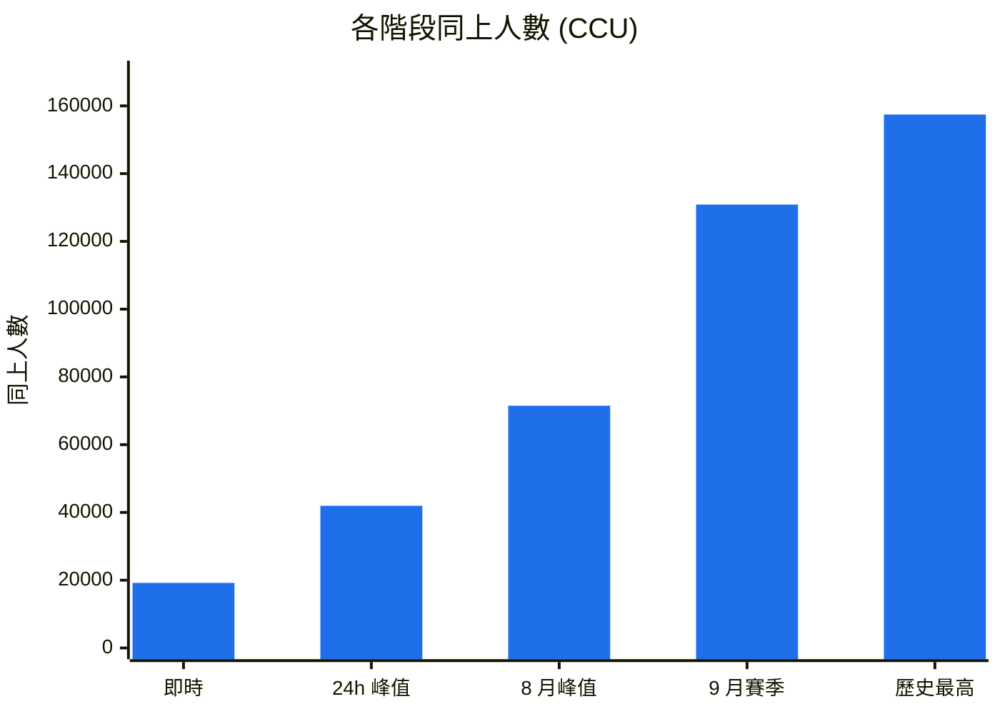
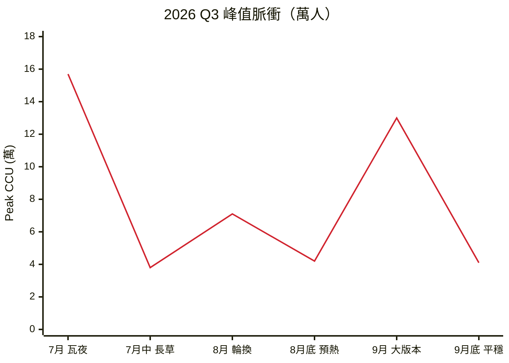

# Limbus Company 數據筆記

2026/10/22 課堂練習，用 Google AI Studio 整理。資料來源 SteamDB，App ID 1973530，抓取時間 03:04 UTC。


## 人數

SteamDB 上五個節點的同上人數：



```text
即時        19,200   [██▍                     ]  12.2%
24h 峰值    41,954   [██████▍                 ]  26.6%
8 月峰值    71,489   [██████████▉             ]  45.4%
9 月賽季   130,870   [███████████████████▉    ]  83.1%
歷史最高   157,444   [████████████████████████] 100.0%
```

即時在線約為歷史峰值的 12%，8 月峰值約 45%。開大版本時人數會拉到平日的六倍以上。歷史最高出現在瓦爾普吉斯之夜限定池。

## 評價


Steam 評價分佈，好評率 88.1%：


| 項目 | 數量 | 佔比 |
| --- | ---: | ---: |
| 好評 | 108,200+ | 88.1% |
| 負評 | 14,500+ | 11.9% |
| 合計 | 122,768 | 100% |

總評論約 12 萬則，好評 88.1%，SteamDB 加權結算 87.01%，評級極度好評。

兩個數字的差別來自權重：SteamDB 會調降早期評論和免費序號評論的影響。對外講這款遊戲用 88.1%，跟其他遊戲比較用 87.01%，基準才一致。

## Q3 峰值



| 時點 | 峰值（萬） | 增減 |
| --- | ---: | ---: |
| 7 月（瓦夜） | 15.7 | — |
| 7 月中（長草期） | 3.8 | −75.8% |
| 8 月（輪換） | 7.1 | +86.8% |
| 8 月底（預熱） | 4.2 | −40.8% |
| 9 月（大版本） | 13.0 | +209.5% |
| 9 月底（平穩） | 4.1 | −68.5% |

活動結束後的跌幅（−70% 到 −76%）大於上線時的漲幅，曲線呈脈衝狀。

## 標籤

Mermaid 沒有原生雷達圖，改用排行呈現：

```text
Story Rich            98  ███████████████████▌
Turn-Based Strategy   94  ██████████████████▊
Dark Fantasy          91  ██████████████████▏
Difficult / Tactical  85  █████████████████
Gacha / Free to Play  74  ██████████████▊
```

權重最高的是 Story Rich（98），最低是 Gacha（74）

## JSON

數字都集中在 repo 根目錄的 `metrics.json`，上方徽章直接讀這檔案。

下面的 payload 是給前端圖表用的版本，格式照 `visualization_generator`：

```json
{
  "dashboard_id": "DASH_STEAM_1973530",
  "generated_at": "2026-10-22T03:04:00Z",
  "game_meta": {
    "app_id": 1973530,
    "title": "Limbus Company",
    "steamdb_rating": 87.01,
    "positive_ratio": 88.1
  },
  "gauges": {
    "live_retention_index": 0.45,
    "event_surge_multiplier": 3.75,
    "sentiment_health_score": 8.7
  },
  "metrics_matrix": [
    {
      "metric": "All-Time Peak CCU",
      "value": 157444,
      "benchmark_genre_avg": 12800,
      "performance_ratio": "+1129.6%"
    },
    {
      "metric": "24h Peak CCU",
      "value": 41954,
      "benchmark_genre_avg": 4500,
      "performance_ratio": "+832.3%"
    },
    {
      "metric": "User Review Volume",
      "value": 122768,
      "benchmark_genre_avg": 18000,
      "performance_ratio": "+582.0%"
    }
  ]
}
```

| gauge | 值 | 說明 |
| --- | ---: | --- |
| `live_retention_index` | 0.45 | 即時在線對峰值的比值 |
| `event_surge_multiplier` | 3.75 | 活動期放大的倍數，可用於壓測 |
| `sentiment_health_score` | 8.7 | 好評率與評論量的綜合分（滿分 10） |

## 備註

- `benchmark_genre_avg` 未標明比較母體，引用前需補定義。
- 總評論數原文有 122,700+ 與 122,768 兩種寫法，前者為約略值，本文統一用 122,768 計算。
- 資料為單次快照，CCU 會隨時間變動。
